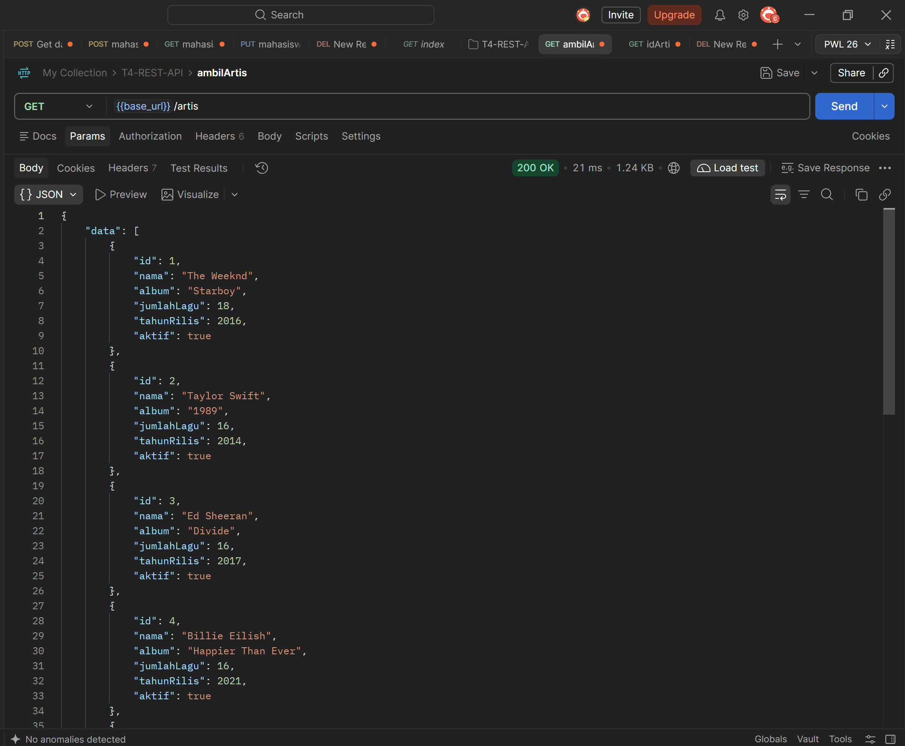
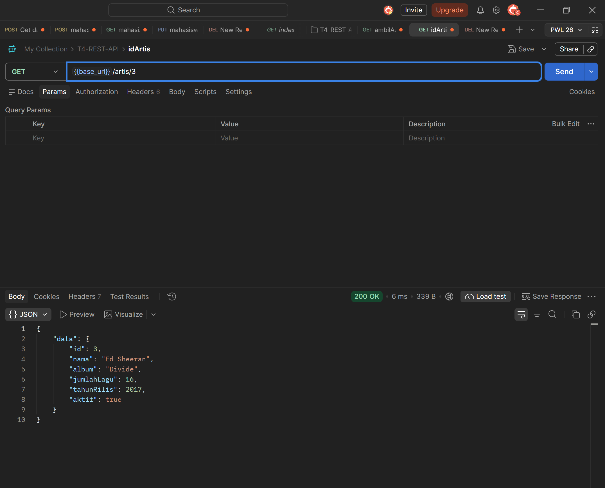
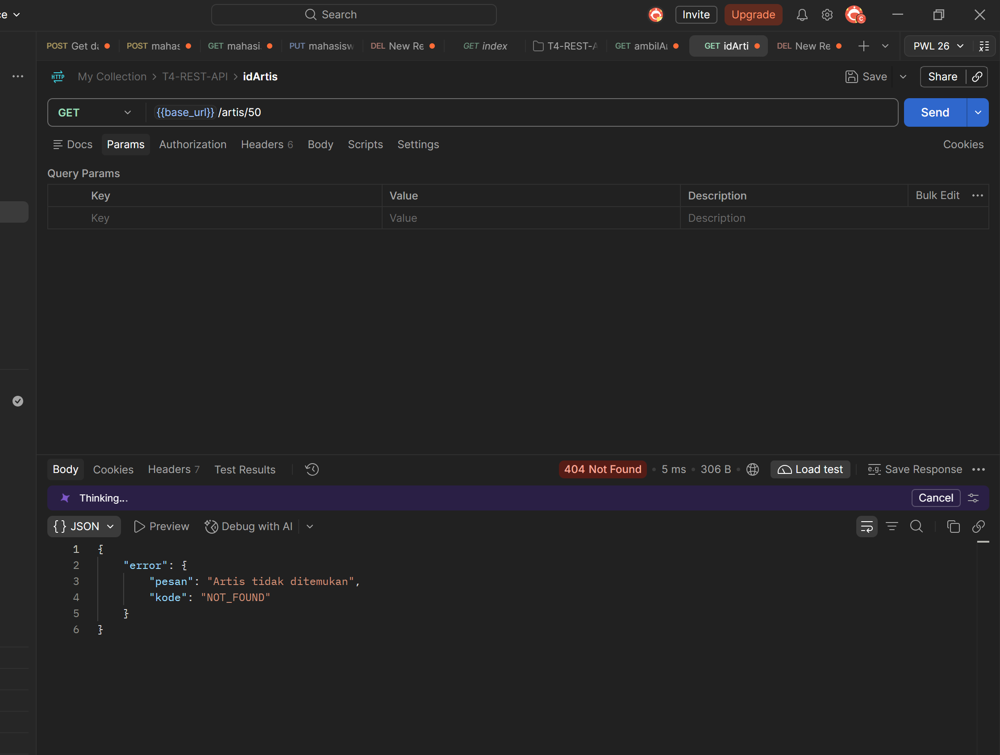
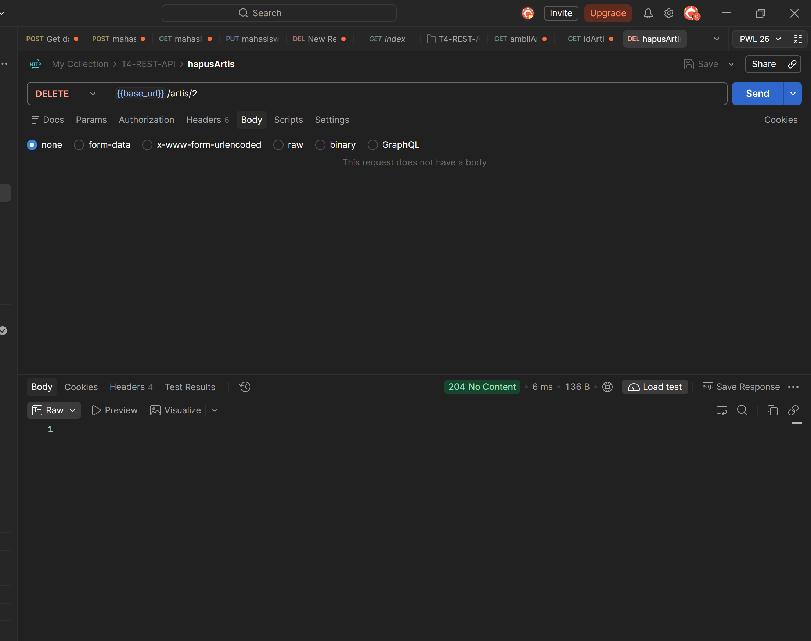

# Tugas 4 - REST API Dasar

## Identitas

* Nama : Cindy Natasya Aulia Putri

* NIM  : \[F1D02310109\]

## Deskripsi Tugas

Saya memilih topik data daftar artis musik karena topik ini sangat relevan dan menarik untuk diimplementasikan dalam bentuk REST API. Data artis memungkinkan pengelompokan yang kaya berdasarkan tahun rilis karya atau genre, sehingga fitur *filtering* query parameter pada Express.js dapat dieksplorasi secara optimal.

## Cara Menjalankan

1. npm install

2. npm run dev

3. http://localhost:3000

## Daftar Endpoint

| 

| **Method** | **URL** | **Fungsi** | **Status** | 
| GET | /artis | Semua artis | 200 | 
| GET | /artis/:id | Satu artis | 200 / 404 | 
| DELETE | /artis/:id | Hapus artis | 204 / 404 | 

## Bentuk Data

Contoh data satu artis dalam format JSON (`src/data/daftarArtis.js`):

```
{
  "id": 1,
  "nama": "Tulus",
  "genre": "Pop",
  "tahunRilis": 2011
}

```

**Penjelasan Field:**

* `id`: Angka unik sebagai identifikasi utama (primary key) untuk setiap data artis.

* `nama`: Nama panggung atau nama grup dari artis musik tersebut.

* `genre`: Aliran musik utama yang diusung oleh sang artis.

* `tahunRilis`: Tahun saat artis mulai debut atau merilis karya pertamanya ke publik.

## Pengujian

### GET daftar

Screenshot: 

### GET detail (id)

Screenshot: 

### GET detail (id tidak ada)

Screenshot: 

### DELETE artis

Screenshot: 

## Deklarasi Penggunaan AI

| **Bagian** | **Alat AI** | **Dipakai untuk apa** | **Bagaimana saya memeriksa hasilnya** | 
| Data (`src/data/daftarArtis.js`) | Gemini | Membuat contoh data daftar artis awal | Saya periksa kembali isi array dan struktur kuncinya agar sesuai dengan logika aplikasi | 
| README | Gemini | Menyusun format file README sesuai template tugas | Saya membaca ulang dan menyesuaikan isi teks dengan implementasi kode saya | 

Pernyataan: Saya menggunakan AI pada bagian yang tertulis di tabel. Bagian lain saya kerjakan sendiri.

## Kesimpulan & Kendala

* **Yang Dipelajari:** Saya belajar bagaimana cara menginisialisasi Express.js, membuat struktur routing dasar dengan parameter dinamis (`:id`), menangani *query parameters* untuk filtering data, serta mengembalikan respons JSON dengan format *error handling* yang seragam.

* **Kendala & Solusi:** Sempat mengalami kendala *SyntaxError* pada terminal saat menjalankan file server karena kesalahan penulisan parameter di fungsi `app.listen`. Kendala tersebut berhasil diatasi dengan memperbaiki sintaks JavaScript yang digunakan agar sesuai dengan standar modul ESM Node.js.